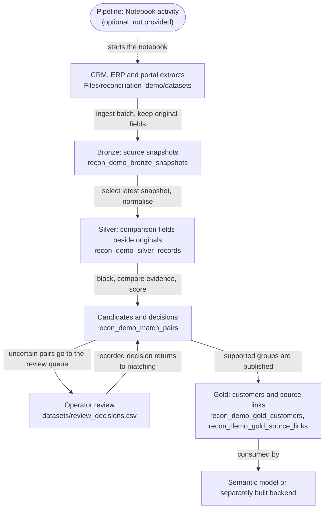

# When Enterprise Data Disagrees

**Reconciliation Patterns in Microsoft Fabric.** Code, data and slides from the session by Daniele Mario Areddu (Backend & AI Developer, Global Technologies Italia) at Data Saturday Sofia 2026.

[](https://github.com/DaniAreddu/fabric-data-reconciliation/actions/workflows/validate.yml)

Two records can have the same name and still refer to different companies. They can also have different addresses and refer to the same company. This repository follows Alfa, Aurora and Delta through the decisions needed to tell those cases apart.

Reconciliation, as used here: **we decide which records describe the same thing, and keep the evidence for that decision.**

## Why a similar name is not enough

| Source key | Name | Address | Postcode | Company ID |
|---|---|---|---|---|
| `CRM:C102` | Aurora Consulting | Verdi Street 8 | 98121 | DEMO-002 |
| `ERP:E502` | Aurora Consulting | Verdi Street 8 | 98121 | DEMO-009 |

Every compared field agrees, so the pair scores 100 out of 100. It is still two companies: the two trusted company IDs disagree, and a contradiction beats a score. Aurora is the plausible false match the rules have to catch.

Alfa is the opposite case. The CRM says "Alfa Ltd, Roma Street 12", the portal "Alfa, Roma Street 10". Their pair scores 45, but both carry the same reliable ID, DEMO-001, so they are one company. Delta sits in between: CRM and ERP agree on everything except that the CRM has no ID, so a reviewer links them using a recorded piece of evidence, while a third Delta row from the portal waits for its own.

## From Messina to Fabric

The patterns come from a real project: a territorial data platform for the Municipality of Messina that reconciled street names across five to six sources, read references from Maggioli and returned validated links to it, built with Python/FastAPI, PostgreSQL/PostGIS and React/TypeScript. [The Messina project](docs/messina.md) explains that loop and what is reconstruction rather than project fact. No project code or data is published here.

The talk then moves the same questions to customer records in Microsoft Fabric. That example is new and runs anywhere Python does:



Source rows keep their original values and keys all the way to Gold. Uncertain pairs go to review, and the recorded decision comes back into matching, where it is applied only while the compared values and the rule version are unchanged. `portal.json` is a saved API extract, not a connection to a live portal.

## Quick start

You need Python 3.10 or later. There is nothing to install.

```bash
git clone https://github.com/DaniAreddu/fabric-data-reconciliation.git
cd fabric-data-reconciliation
python reference.py
python -m unittest discover -s tests
```

On Windows, use `py` instead of `python` if the launcher is what you have. `reference.py` checks the decision rules, writes the B001 and B002 results to `output/` and compares them with the versioned files in [`expected/`](expected). It ends with:

```text
Checks passed: routing, null IDs, conflict override, stale review, group guard, rerun and update.
Generated B001 and B002 results match expected/ (written to output).
```

To run the PySpark notebook in a Fabric Lakehouse, follow [the Fabric setup guide](docs/fabric-setup.md).

## What B001 produces

| Outcome | Count |
|---|---:|
| Source records (4 CRM, 3 ERP, 2 portal) | 9 |
| Possible cross-source pairs | 26 |
| Candidate pairs after blocking | 7 |
| Linked automatically by a shared ID | 3 |
| Sent to review | 3 |
| Blocked by an ID conflict (Aurora) | 1 |
| Approved in review (Delta CRM–ERP) | 1 |
| Published companies | 5 |
| Published source links | 8 |
| Held source records (`PORTAL:P902`) | 1 |

Batch B002 changes Alfa's ERP billing address to Roma Street 14. Bronze then holds ten snapshots, and Gold still holds five companies, with Alfa keeping customer ID `CUS-a60635aa3160`. These counts show the example follows its rules; they are not an accuracy measurement.

## Slides and talk

Both editions use the same 40 slides and differ in their speaker notes.

| Edition | Slides | Speech and timing | Estimated length |
|---|---|---|---|
| Extended | [PPTX with notes](presentations/Sofia_2026_English_Extended_Final.pptx) · [PDF](presentations/Sofia_2026_English_Extended_Final.pdf) | [Speech](talks/extended/Sofia_2026_English_Extended_Speech.md) · [Timing](talks/extended/Sofia_2026_English_Extended_Timing.md) | 57:12 |
| 50-minute slot | Deck files not included in this release | [Speech](talks/50min/Sofia_2026_English_50min_Speech.md) · [Timing](talks/50min/Sofia_2026_English_50min_Timing.md) | 49:52 |

The estimates come from word counts at 110 words per minute and include eight minutes of Q&A and a two-minute margin; see [talks](talks/README.md). There is also a one-page [reconciliation checklist](presentations/reconciliation_checklist.pdf).

## Try it on your own data

Pick two sources. Keep their original keys. Label a small set of pairs, including difficult negatives, before choosing matching rules.

## What has been verified

The local reference, 53 unit tests and the repository checks pass on Python 3.10 to 3.14 and run in CI on every push. The notebook is checked structurally: valid format, every code cell compiles, and its rules are identical to `reference.py`. It has not been run in a Fabric workspace for this repository, and the expected results come from the local reference. The [validation report](docs/validation.md) lists the commands and their results.

## Further reading

- [How the decisions are made](docs/reconciliation.md): keys, blocking, rule order, review, groups, survivorship and Gold, record by record
- [Datasets](docs/datasets.md): fields, origin and the B002 update
- [Running the notebook in Fabric](docs/fabric-setup.md)
- [From the example to production](docs/production.md)
- [The Messina project](docs/messina.md) · [Questions](docs/faq.md) · [References](docs/references.md)
- [Contributing](CONTRIBUTING.md)

## Author, licenses and sources

Daniele Mario Areddu · [GitHub](https://github.com/DaniAreddu) · [LinkedIn](https://it.linkedin.com/in/daniele-mario-areddu-67729b260) · [Sessionize](https://sessionize.com/daniele-mario-areddu/)

Original code and synthetic fixtures are under the [MIT license](LICENSE). Documentation, talk scripts and the original slide content are under [CC BY 4.0](LICENSE-DOCS). The Messina public data, the Messina photograph, Microsoft documentation images, Fabric icons and fonts keep their own licenses, and the portrait, QR code, logos and event identity in the decks are not licensed by this repository. [LICENSES.md](LICENSES.md) maps every path to its terms, and [asset_sources.md](asset_sources.md) records the origin of each dataset, piece of evidence and image.
