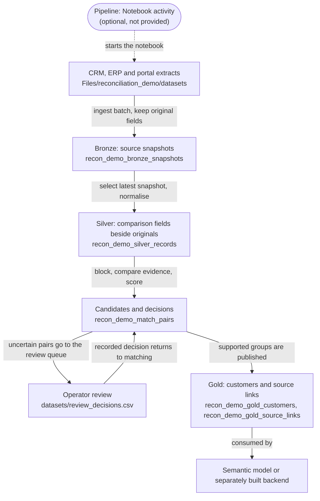
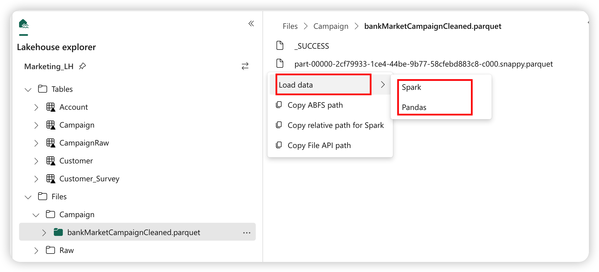
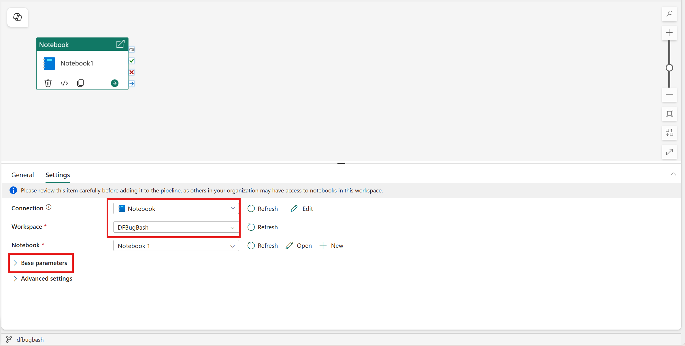

# Running the notebook in Microsoft Fabric

[`fabric_reconciliation.ipynb`](../fabric_reconciliation.ipynb) runs the same rules as `reference.py` with PySpark and Delta tables in a Fabric Lakehouse.

**Status.** Three different checks exist, and only the first two have been done for this repository:

| Check | Status |
|---|---|
| Local reference: `python reference.py` and the unit tests produce the versioned results | Passing, also in CI |
| Notebook structure: valid nbformat, every code cell compiles, embedded rules identical to `reference.py` | Passing, also in CI |
| Notebook run in a Fabric workspace | **Not done.** No Fabric output is published here |

The expected results in `expected/` come from the local reference, not from a Fabric run. The notebook asserts the same B001 and B002 counts, so a first run in your workspace will tell you whether it behaves the same way there. Please [open an issue](../CONTRIBUTING.md#reporting-a-problem) with what you see.

## What each part of Fabric does

Follow `CRM:C101`, one of Alfa's rows:

- **OneLake** stores the data. Every Lakehouse lives in it.
- **The Lakehouse** shows two areas. `Files` holds the uploaded extracts, including `crm.csv` with C101 as it arrived. `Tables` holds the Delta tables the notebook writes: C101's snapshot in `recon_demo_bronze_snapshots`, its comparison fields in `recon_demo_silver_records`, and later its link to Alfa's customer ID.
- **The Notebook (PySpark)** implements the rules: it ingests, normalises, selects candidates, applies saved reviews, checks groups and publishes.
- **A Pipeline** can coordinate the work, for example by starting the notebook when new extracts arrive. It does not contain reconciliation logic. No pipeline is included in this repository.
- **The operator** records decisions for uncertain pairs. Here that is the CSV file `datasets/review_decisions.csv`; there is no review application.
- **Gold** publishes `recon_demo_gold_customers` and `recon_demo_gold_source_links`: Alfa's customer ID, the source of each chosen value and the three source rows that belong to it.
- **A semantic model** for reports, or **a backend** built separately for applications, consumes the Gold tables suited to its use. Neither is included.

Reconciliation is application logic written in this notebook. Fabric provides storage, compute and orchestration; it does not decide which records describe the same company.



Solid arrows carry data; the dashed arrow is coordination.

## 1. Prerequisites

- Access to a Fabric tenant with capacity (a trial capacity is enough) and a workspace assigned to it.
- Permission to create a Lakehouse and a Notebook in that workspace.
- The files from this repository's `datasets/` folder and `fabric_reconciliation.ipynb` on your computer.

Use a workspace, or at least a Lakehouse, created only for this exercise. The notebook overwrites its own derived tables on every run, and the steps below for starting again remove them. Do not run it against a Lakehouse that holds working data.

No package installation is needed. The notebook uses PySpark, Delta Lake and the Python standard library available in the Fabric Spark runtime.

## 2. Import the notebook and attach the Lakehouse

1. In the workspace, create a Lakehouse, for example `reconciliation_demo`.
2. Import `fabric_reconciliation.ipynb` from the workspace toolbar. Fabric recognises standard `.ipynb` files and creates a notebook item.
3. Open the notebook. In the Lakehouse explorer on the left, select **Add lakehouse**, choose the Lakehouse you created and make it the default by pinning it.
4. If you pinned or renamed the default Lakehouse while a session was running, restart the session.

The default Lakehouse is mounted at `/lakehouse/default/`. The notebook reads from that mount and writes its tables to the default Lakehouse.



*Lakehouse explorer in a notebook. Screenshot from the Microsoft Learn article [Load data into your lakehouse with a notebook](https://learn.microsoft.com/en-us/fabric/data-engineering/lakehouse-notebook-load-data), © Microsoft, CC BY 4.0. Table names belong to Microsoft's sample, not to this exercise.*

## 3. Upload the datasets

In the Lakehouse explorer, under **Files**, create the folder `reconciliation_demo` and inside it `datasets`. Upload the contents of this repository's `datasets/` folder there, so that the files are at:

```text
Files/reconciliation_demo/datasets/crm.csv
Files/reconciliation_demo/datasets/erp.csv
Files/reconciliation_demo/datasets/portal.json
Files/reconciliation_demo/datasets/review_decisions.csv
Files/reconciliation_demo/datasets/labelled_pairs.csv
Files/reconciliation_demo/datasets/erp_B002.csv
```

These six files are the ones the notebook reads. Uploading the rest of the folder does no harm; the notebook ignores the Messina and A–B–C files.

## 4. Check the configuration cell

The first code cell sets three values:

| Setting | Value in the notebook | Meaning |
|---|---|---|
| `BASE` | `Path('/lakehouse/default/Files/reconciliation_demo')` | Folder of the uploaded extracts, through the default Lakehouse mount. Files are read from `BASE / 'datasets'` |
| `PREFIX` | `'recon_demo_'` | Prefix of every table the notebook creates |
| `SCHEMA` | `''` | Empty means tables go to the Lakehouse's default namespace. Set it to a schema name, for example `'dbo'`, if your Lakehouse needs an explicit one; table names then become `dbo.recon_demo_...` |

The prefix keeps the exercise's tables together in one Lakehouse. It illustrates medallion roles; it is not an access boundary. Microsoft's guidance for real projects is to keep each layer in its own Lakehouse, preferably in its own workspace.

## 5. Run the cells in order

Run the notebook from the top, one section at a time.

| Section | What it does | Tables written |
|---|---|---|
| Configuration (first code cell) | Imports, `BASE`, `PREFIX`, `SCHEMA`, helpers | none |
| 1 · The same explicit rules | Defines the functions shared with `reference.py` | none |
| 2 · Load extracts and preserve Bronze snapshots | Reads CRM, ERP and portal as batch B001 and ingests them twice to show that a rerun adds nothing; asserts nine B001 snapshots | `recon_demo_bronze_snapshots`: created on first run, then insert-only. Never overwritten |
| 3 · Silver makes fields comparable | Defines `build_silver()` | (written in section 6) |
| 4 · Generate candidates before scoring | Defines `build_pairs()` | none |
| 5 · A review decision adds evidence | Loads `review_decisions.csv`, requires one decision per pair | `recon_demo_review_decisions`: overwritten |
| 6 · Check whole groups, then choose values by field | Runs B001: Silver, candidates, reviews, grouping, Gold; asserts the B001 counts; shows Gold and the review queue | `recon_demo_silver_records`, `recon_demo_exceptions`, `recon_demo_match_pairs`, `recon_demo_review_queue`, `recon_demo_gold_customers`, `recon_demo_gold_source_links`, `recon_demo_held_records`: overwritten. `recon_demo_run_metrics`: one row per run ID, updated if the run ID already exists |
| 7 · Count outcomes and evaluate labelled pairs | Compares routes with `labelled_pairs.csv`, ignoring `UNKNOWN` | none |
| 8 · Ingest one changed source record | Loads B002, reruns the reconciliation and checks Alfa | as section 6, with run ID B002 |

Each derived table is overwritten on every run and represents the current publication. Bronze and the run history are the only tables that accumulate.

## 6. Check B001 before running section 8

After section 6 the notebook prints the B001 metrics and two tables. They should match the local reference:

| Metric | Expected |
|---|---:|
| `input_records` | 9 |
| `candidate_pairs` | 7 |
| `automatic_pairs` | 3 |
| `initial_review_pairs` | 3 |
| `conflicting_pairs` | 1 |
| `approved_review_pairs` | 1 |
| `published_entities` | 5 |
| `published_source_links` | 8 |
| `held_records` | 1 |

The notebook also asserts these values, so a difference stops the run with an `AssertionError`. Compare `recon_demo_gold_customers` with `gold_customers` in [`expected/B001_results.json`](../expected/B001_results.json): Alfa should be `CUS-a60635aa3160` with billing address `Roma St., 12` from `ERP:E501`. `recon_demo_review_queue` should list the two pairs with `PORTAL:P902`, each scoring 95.714286. Section 7 should print four true positives and no false positives or false negatives.

## 7. What B002 changes, and how to start again

Section 8 ingests `erp_B002.csv` as batch B002 (twice, to show it adds nothing the second time) and reruns everything. Afterwards Bronze holds ten snapshots, the current view nine rows, and Gold still five companies. Alfa keeps `CUS-a60635aa3160` and its billing address becomes `Roma Street 14`.

B002 stays in Bronze. Running section 6 again afterwards does **not** take you back to B001: the latest snapshot is still B002, so Gold keeps `Roma Street 14`, and because the counts are the same the B001 assertions still pass while the B001 row of `recon_demo_run_metrics` is overwritten with post-B002 results.

To repeat the B001 demonstration:

- **Simplest:** create a new Lakehouse, attach it as the default, upload the datasets and run from the top.
- **In the same exercise Lakehouse:** after running the configuration cell, drop the exercise tables and run from section 1 again.

```python
# Only in a Lakehouse created for this exercise: removes the recon_demo_ tables it created.
for role in ['bronze_snapshots', 'silver_records', 'exceptions', 'review_decisions', 'match_pairs',
             'review_queue', 'gold_customers', 'gold_source_links', 'held_records', 'run_metrics']:
    spark.sql('DROP TABLE IF EXISTS ' + table_name(role))
```

This snippet has not been run in Fabric for this repository. It drops only the ten tables listed, through the notebook's own `table_name()` helper.

## 8. Optional: start the notebook from a Pipeline

To run the notebook on a schedule or after files arrive, add it to a Fabric Pipeline with a Notebook activity: create a pipeline, add **Notebook** from the **Activities** pane, then on the **Settings** tab choose the connection and the notebook. Save, then **Run** or **Schedule** from the **Home** tab.



*Notebook activity settings. Screenshot from the Microsoft Learn article [Notebook activity](https://learn.microsoft.com/en-us/fabric/data-factory/notebook-activity), © Microsoft, CC BY 4.0. It does not show a pipeline built for this repository.*

Keep in mind:

- The notebook has no parameter cell, so there are no base parameters to pass. It always reads the same files.
- A pipeline run executes under the identity of the user who last modified the pipeline.
- A successful activity only means the notebook finished. A production pipeline should also check that the expected extracts arrived and that publication passed its checks; the notebook's assertions are a first step.
- The repository provides no pipeline definition, trigger or upload process. Those belong to your environment.

## 9. Troubleshooting

**No Lakehouse attached.** Reading `/lakehouse/default/...` fails, or `saveAsTable` cannot create tables. Attach the Lakehouse in the explorer, pin it as default and restart the session.

**Files not found.** Spark reports that the path does not exist. Check the exact location: `Files/reconciliation_demo/datasets/crm.csv`, not `Files/datasets/...` and not `Files/reconciliation_demo/datasets/datasets/...`. File names are case-sensitive. If the path is right and still not found, right-click the file and use **Copy relative path for Spark** or **Copy ABFS path**; setting `BASE` to the folder above `datasets` in that form (for example `Path('Files/reconciliation_demo')`) is an alternative this repository has not tested.

**Schema errors.** If table creation fails with a namespace or schema message, set `SCHEMA` to the schema your Lakehouse uses, for example `'dbo'`, and run from the configuration cell. This path has not been tested here either.

**"Existing batch/key has different source evidence".** Bronze already contains batch B001 with different values, typically after editing a CSV. That error is the protection working. Use a fresh Lakehouse or give the changed extract a new batch ID.

**Different results.** An `AssertionError` in section 6 or 8 means the run disagrees with the reference. Common causes:

- `approved_review_pairs` is 0: a compared field of `CRM:C103` or `ERP:E503` differs from the repository, so the saved fingerprint no longer matches. Upload the original files.
- Gold shows `Roma Street 14` before section 8: B002 was ingested earlier in this Lakehouse. Start again as described above.
- Other counts differ: check that all six files were uploaded unmodified (an editor that re-saves a CSV can change values) and run `python reference.py` locally to confirm the repository itself is consistent.

If none of this explains it, please report it with the printed metrics and the Fabric runtime version.
