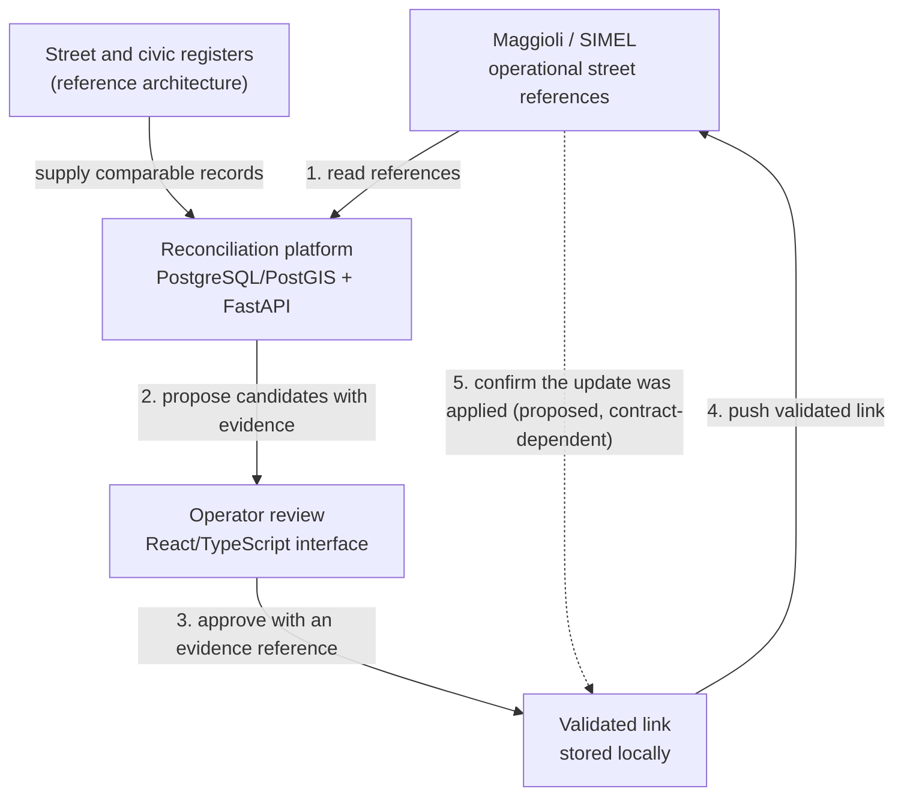

# The Messina project

The talk starts from a real project: a territorial data platform for the Municipality of Messina, in Sicily. Daniele Mario Areddu led its architecture, development and production delivery. The platform reconciled odonyms (the names of streets and other circulation areas) and managed territorial data across five to six sources.

What the project involved, as far as this repository can state it:

- reading street references from Maggioli and returning validated links to Maggioli;
- normalisation, matching, trigram search, reconciliation and deduplication;
- a backend in Python/FastAPI on PostgreSQL/PostGIS and an operator interface in React/TypeScript;
- ETL, APIs, Docker, deployment and stabilisation in production.

Maggioli is the supplier; SIMEL is the municipal information system in that context. Together they are one operational node, not two sources. The materials do not establish which SIMEL release the municipality runs.

None of the project's code, data or documents are published here. The keys and records on this page are invented to explain the pattern; [asset_sources.md](../asset_sources.md) separates project facts from reconstruction in detail.

## The operating loop

1. **Read references** from the operational system.
2. **Compare** them with other descriptions of the same street to find candidates.
3. **Have the evidence checked** by an operator.
4. **Validate the link** and keep its reason.
5. **Send it** to the system that needs it.
6. **Check the outcome** when the receiving system's contract allows it.

Reading from and pushing to Maggioli were part of the project. The street and civic registers in the diagram, like the regional maps, cadastral extracts and office exports named on slide 6, are a reference architecture. They make the pattern concrete; they are not a list of integrations the original project had.

Step 6 and its dashed arrow are a proposed pattern. A link saved locally and an update accepted by the destination are different states. Keeping both visible shows where a process stopped: if the destination rejects the update, the link is validated locally but not confirmed there. A retry must not create duplicate effects, which requires an idempotent operation on the destination side. Whether that exists depends on the real contract. The talk does not claim the original system implemented confirmation, retry or idempotency.

## A street link, step by step

The example uses three invented records from [`messina_example_records.csv`](../datasets/messina_example_records.csv):

| Source key | Name | Area type | Role |
|---|---|---|---|
| `MAG:ODN:000184` | A. Celi Street | Street | operational row without a street link |
| `TOP:STR:000531` | Adolfo Celi Street | Street | street register row |
| `OFF:ROW:000009` | Adolfo Celi Square | Square | office row with a different area type |

"A. Celi Street" looks like an abbreviation of "Adolfo Celi Street": a candidate worth checking. "Adolfo Celi Square" has a similar name but a different kind of area, so the name and the area type are kept as separate fields. Dropping the type would make two different objects look equal.

Trigram search in PostgreSQL compares small groups of characters and finds the candidate. It does not decide the link. A checked reference table associates the operational key and the street-register key with the same street; the operator records that check as `REF-CELI-01` and approves the street link ([`messina_review_decisions.csv`](../datasets/messina_review_decisions.csv)). The decision supports those two keys and that kind of object only. It is not evidence for merging two civic addresses. Its status, `VALIDATED_LOCAL_TARGET_PENDING`, records that the destination has not yet confirmed the update.

`REF-CELI-01` is an illustrative reference written for the talk, not a project document or a SIMEL contract. Via Adolfo Celi itself is a real street in the municipal address register.

## One street, two addresses

Two real rows from the municipal open data ([`messina_public_sample.csv`](../datasets/messina_public_sample.csv)):

| Address ID | Official name | Display name | Civic |
|---|---|---|---|
| `019e5e6c-85d2-7c04-9a36-83f3168ca0a0` | VIALE BOCCETTA | Boccetta Avenue | 63 |
| `019e5e66-65b4-783a-9192-2f37fbc19e9f` | VIALE BOCCETTA | Boccetta Avenue | 65 |

Both belong to the same street, and each keeps its own address identity and civic number. A street, an address and an access point are different objects: a street link checks the street reference, while an address link also depends on the civic number and the local address identity. Two entrances can serve one building, and nearby points do not prove two addresses are the same.

The display names come from [`messina_display_labels.csv`](../datasets/messina_display_labels.csv). The public file keeps the official Italian values.

## Location is context, not proof

PostGIS stores and queries geometry, which helps narrow a search. Similarity and proximity remain clues.

Units matter for distance rules. The sample's `lat` and `long` are WGS84 degrees. With PostGIS `geometry`, `ST_DWithin` measures distance in the units of the spatial reference system, so in degrees for WGS84. With `geography` it measures in metres. A threshold written as "50" means something very different in each case. The repository does not compute distances and adds no coordinates beyond those published by the municipality.

## What could go wrong without it

A wrong or missing link turns into someone's work. Possible consequences include a letter or fine notice sent to the wrong place, a delayed service, a territorial case pointing to the wrong area, duplicates that change maps or counts, and an operator rebuilding references by hand. These are scenarios used to explain the stakes, not documented incidents in Messina, and not a claim about which services the platform supported.

## From streets to customers

The same questions return when the object is a company instead of a street: are these records the same kind of object, what supports or contradicts the link, and can we trace each published value? The customer example in Microsoft Fabric ([How the decisions are made](reconciliation.md)) applies those patterns to new data. It is a separate teaching example, not a port of the Messina system.
