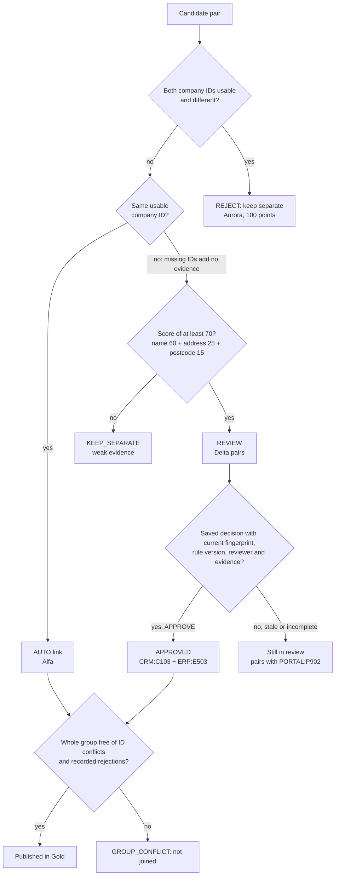
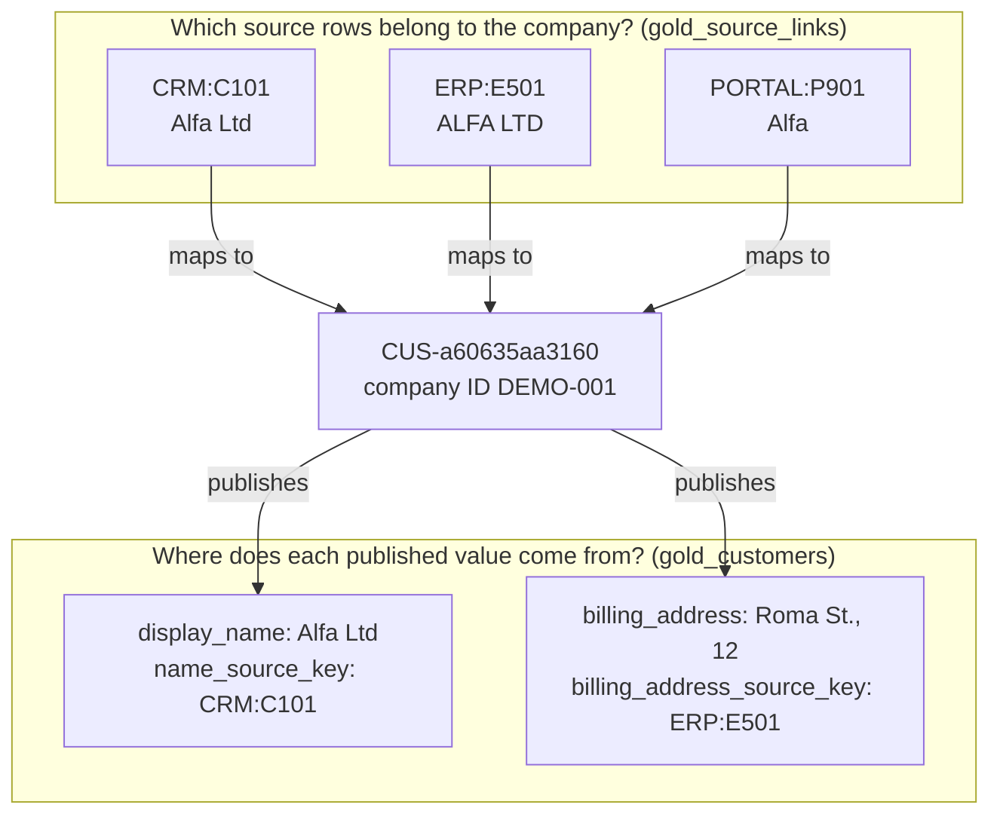

# How the decisions are made

This page follows the nine company records through the rules in [`reference.py`](../reference.py). The notebook embeds the same functions, so everything here applies to both. Every number below comes from [`expected/B001_results.json`](../expected/B001_results.json) or [`B002_results.json`](../expected/B002_results.json) and is checked by the tests.

| Company | Source rows | What happens |
|---|---|---|
| Alfa | `CRM:C101`, `ERP:E501`, `PORTAL:P901` | One company: all three share the reliable ID `DEMO-001` |
| Aurora | `CRM:C102`, `ERP:E502` | Two companies: same name and address, different IDs |
| Delta | `CRM:C103`, `ERP:E503`, `PORTAL:P902` | CRM and ERP linked after review; the portal row is held |
| Nova | `CRM:C104` | One company with no candidate pair |

## Two kinds of key

`CRM:C101` finds a row. It means "record C101 in the CRM", and nothing more: another system could use C101 for something unrelated, which is why every source key carries its namespace. Source keys are never replaced. They stay attached to the published customer so anyone can return to the original rows.

`DEMO-001` makes a claim about identity: this row describes company DEMO-001. The exercise *assumes* the DEMO IDs are reliable company identifiers. In real data that assumption has to be earned: who issues the ID, which kind of entity it identifies (a company, a site, an account) and how often it is wrong.

The code only checks the format. `usable_id()` accepts values matching `DEMO-` plus three digits and turns everything else into an empty string. A well-formed ID can still belong to someone else, be shared by two companies or be mistyped. Format validation does not certify ownership, uniqueness or correctness.

## Keep what arrived, then add comparable fields

Bronze stores each source row as received, with its source, batch and load time. A snapshot is identified by source, record ID and batch: loading the same batch again adds nothing, and reusing a batch key for different values raises an error instead of silently replacing history.

Silver adds comparison fields beside the originals. For Alfa:

| Source key | `company_name` | `name_norm` | `address` | `address_norm` | `postcode_norm` |
|---|---|---|---|---|---|
| `CRM:C101` | Alfa Ltd | alfa ltd | Roma Street 12 | roma street 12 | 98100 |
| `ERP:E501` | ALFA LTD | alfa ltd | Roma St., 12 | roma street 12 | 98100 |
| `PORTAL:P901` | Alfa | alfa | Roma Street 10 | roma street 10 | 98100 |

Names are lower-cased with punctuation removed. Addresses also expand `St.` to `Street`, so `Roma St., 12` and `Roma Street 12` compare equal. The portal's house number 10 survives: a rule that dropped numbers would hide the evidence that separates two addresses. This is normalisation, and it is deliberately small. It handles these English forms, not international addresses in general.

## Which pairs are compared

Four CRM rows, three ERP rows and two portal rows give 4×3 + 4×2 + 3×2 = 26 possible pairs across different sources. Comparing all of them is fine for nine rows and impossible for nine million, so a cheap filter chooses which pairs to score. A pair is kept when either:

- both rows carry the same usable company ID, or
- both have the same non-empty postcode and their normalised names start with the same three characters.

`CRM:C103` (Delta Services, 98122, no ID) and `PORTAL:P902` (Delta Service, 98122, no ID) pass the second rule: same postcode, both names start with `del`. `CRM:C104` (Nova Travel, 00100, no ID) and `PORTAL:P901` (Alfa, 98100, DEMO-001) pass neither, so they are never compared. Seven of the 26 pairs remain.

This filter is called blocking. It is a choice to measure, not a guarantee: a true match with a mistyped postcode and a missing ID would never reach the scoring step, and no later rule can recover a pair it never sees. Check coverage on a labelled sample that includes such cases.

In the notebook, the two rules run as two keyed joins whose results are combined and de-duplicated. Alfa's CRM–portal pair satisfies both rules and still appears once.

## Evidence, in the order that changes the decision

1. **Two usable IDs that disagree stop the link** (`REJECT`, reason `ID_CONFLICT`), whatever the score.
2. **A shared usable ID links automatically** (`AUTO`, reason `EXACT_DEMO_ID`). That is only acceptable because the exercise stipulates reliable IDs.
3. **Otherwise the pair is scored.** 60 × name similarity, plus 25 if the normalised addresses are equal and non-empty, plus 15 if the postcodes are equal and non-empty. Name similarity is 1 − edit distance ÷ length of the longer normalised name. A score of at least 70 sends the pair to review (`REVIEW`); anything lower stays separate (`KEEP_SEPARATE`).
4. **Two missing IDs add nothing.** An empty ID is missing evidence, not agreement, and a malformed ID is treated as missing.

| Pair | Score | Route | Why |
|---|---:|---|---|
| `CRM:C101` – `ERP:E501` | 100 | AUTO | shared DEMO-001 |
| `CRM:C101` – `PORTAL:P901` | 45 | AUTO | shared DEMO-001 despite a low score |
| `ERP:E501` – `PORTAL:P901` | 45 | AUTO | shared DEMO-001 |
| `CRM:C102` – `ERP:E502` | 100 | REJECT | DEMO-002 against DEMO-009 |
| `CRM:C103` – `ERP:E503` | 100 | REVIEW, then APPROVED | CRM has no ID; review evidence ONB-DELTA-42 |
| `CRM:C103` – `PORTAL:P902` | 95.714286 | REVIEW | no IDs; similar name, same address and postcode |
| `ERP:E503` – `PORTAL:P902` | 95.714286 | REVIEW | the portal row has no ID |

The Delta–portal score is 60 × (1 − 1/14) + 25 + 15: "delta services" and "delta service" differ by one character in fourteen.

The weights and the threshold are illustrative. The score measures how many fields agree under these rules. It is not the probability that two records describe the same company.

## Three decisions to remember

**Alfa: different text, same company.** The CRM says "Alfa Ltd, Roma Street 12", the ERP "ALFA LTD, Roma St., 12" and the portal "Alfa, Roma Street 10". The portal pairs score only 45, yet all three rows link because they carry the same reliable ID. Relying on the score alone would leave Alfa split. Which address to publish is a separate decision, made later and for a specific use.

**Aurora: same text, two companies.** Both rows say "Aurora Consulting, Verdi Street 8, 98121": name, address and postcode agree, so the score is 100. The CRM carries DEMO-002 and the ERP DEMO-009. Since both IDs are trusted, the contradiction wins and Gold publishes two companies. If the conflict check ran after a high-score approval, the pipeline would run successfully and produce the wrong answer. Rule order is part of the rule and is covered by a test, including a case where a saved approval for the Aurora pair is ignored.

**Delta: evidence for one pair only.** `CRM:C103` has no company ID, so its pair with `ERP:E503` goes to review even though every field agrees. A reviewer checks the onboarding reference `ONB-DELTA-42`, which associates C103 with DEMO-003, the ID that E503 already carries, and approves that pair. `PORTAL:P902` (Delta Service, no ID) is outside that evidence. Its two pairs stay in review, and the portal row is held out of Gold. The two open pairs concern one portal row, not two extra customers.

`ONB-DELTA-42` is an illustrative reference written for this example; [teaching_evidence.json](../datasets/teaching_evidence.json) records what it supports and what it does not.

## A review that can be reused

The saved decision in [`review_decisions.csv`](../datasets/review_decisions.csv) holds:

| Field | Value for Delta |
|---|---|
| `pair_key` | `CRM:C103\|ERP:E503` |
| `decision` | `APPROVE` |
| `reviewer` | `demo_reviewer` |
| `reviewed_at` | `2026-10-08T10:00:00Z` |
| `evidence_reference` | `ONB-DELTA-42` |
| `rule_version` | `recon-demo-v2-en` |
| `evidence_fingerprint` | `b5bc78d1…6041` |

The fingerprint is a SHA-256 hash of the rule version and the original values the rules compare: source key, company name, company ID, address, postcode and city of both rows. On each run the decision is applied only if the pair is still routed to review and the fingerprint, rule version, reviewer and evidence reference all check out. A changed address, a new rule version or a missing evidence reference sends the pair back to review with reason `STALE_OR_INCOMPLETE_REVIEW`. Load metadata such as batch or load time is not part of the fingerprint, so reloading an unchanged row keeps the approval.

The fingerprint detects changed inputs; it does not prove identity. It also cannot notice that the evidence itself has been withdrawn, for example an onboarding record later found to be wrong. The reference does not handle withdrawal; a production flow needs a way to flag decisions that rest on withdrawn evidence ([production.md](production.md)).

## Checking the whole group

Approving pairs one at a time can still build a group that contradicts itself. [`group_check_example.csv`](../datasets/group_check_example.csv) is a separate three-row example, not part of the customer data:

| Node | Source key | Company ID | Proposed link |
|---|---|---|---|
| A | `CRM:A` | DEMO-002 | to B |
| B | `ERP:B` | (none) | to C |
| C | `PORTAL:C` | DEMO-009 | |

Accept A–B. Before adding C through B, the grouping step looks at every member of the group that would result: it would contain DEMO-002 and DEMO-009. B's empty ID cannot remove that conflict, so the second link becomes `GROUP_CONFLICT` and is not applied. The same check stops a union that would put a previously rejected pair into one group. A reviewer's approval for a single pair does not bypass it.

When a pair is still unresolved, publication follows an explicit policy: if one side is already a supported group and the other is a single row, the group publishes and the single row is held. That is how Delta's CRM–ERP group publishes while `PORTAL:P902` waits. Other unresolved pairs hold both sides. This policy suits the example; each domain should choose its own.

## Choosing the published values

Start from the use. A billing address must reach the department that sends invoices; a delivery address or a site may be different and should not overwrite it.

The example publishes:

- `display_name` from the first non-empty value in source order CRM, ERP, portal;
- `billing_address` from the first non-empty value in source order ERP, CRM, portal.

If the ERP address were empty, billing would fall back to the CRM value, and a test covers that case. Choosing the published value for each field is called survivorship. Source priority is a business policy, not proof that a value is suitable. Production needs address validation for the intended use and a recorded reason for every fallback.

The portal's "Roma Street 10" is not published, but it is not lost either: it stays in Bronze and Silver. It may describe another site or an older value.

## What Gold answers

Gold answers two separate questions:

- **Which source rows belong to this company?** `gold_source_links` maps `CRM:C101`, `ERP:E501` and `PORTAL:P901` to `CUS-a60635aa3160`, with each row's batch and source update time.
- **Where did each published value come from?** `gold_customers` stores the source key next to each chosen field: the name from `CRM:C101`, the billing address from `ERP:E501`.

Three rows belong to Alfa, but only two of them supply published values. Mixing the two questions makes it impossible to explain either.

The customer ID is `CUS-` plus the first 12 hex characters of a SHA-256 hash of the reliable company ID (`business:DEMO-001`), or of the first source key when a group has no usable ID (Nova: `source:CRM:C104`).

## The next batch: B002

[`erp_B002.csv`](../datasets/erp_B002.csv) sends one changed row: `ERP:E501` now has billing address `Roma Street 14`, updated at `2026-10-09T08:00:00Z`.

- Bronze keeps both versions: ten snapshots. The current view still has nine rows, one per source key, and B002 adds nothing if loaded twice.
- The CRM–ERP Alfa pair now scores 75 instead of 100 because the addresses differ, but the shared DEMO-001 still links it automatically.
- Alfa keeps `CUS-a60635aa3160`. Gold publishes `Roma Street 14` from `ERP:E501`, and the source link records batch B002.
- Delta's compared fields did not change, so its saved approval still applies. Five companies are published, as before.

The identity stays stable *in this case*. A new conflicting ID would stop the automatic link, a changed Delta field would make the approval stale, and new evidence could justify re-examining earlier decisions. The notebook loads only the changed row but recomputes candidates on the whole current snapshot: incremental ingestion, not incremental matching.

## What the counts mean

B001 produces seven candidates (three automatic, three for review, one conflict), one approved review, five published companies, eight source links and one held row. These numbers show that the exercise follows its rules. They are not accuracy.

[`labelled_pairs.csv`](../datasets/labelled_pairs.csv) labels five pairs as `MATCH` or `DIFFERENT`, and the routes agree with all five: four accepted matches, no accepted non-match, no missed match. The two portal pairs are labelled `UNKNOWN` and stay out of the calculation, because nobody has the evidence to label them. Five labels written alongside the rules are a conformance check. Measuring false links, missed links and blocking coverage needs a larger labelled sample, chosen independently of the rules and including difficult negatives such as Aurora.
